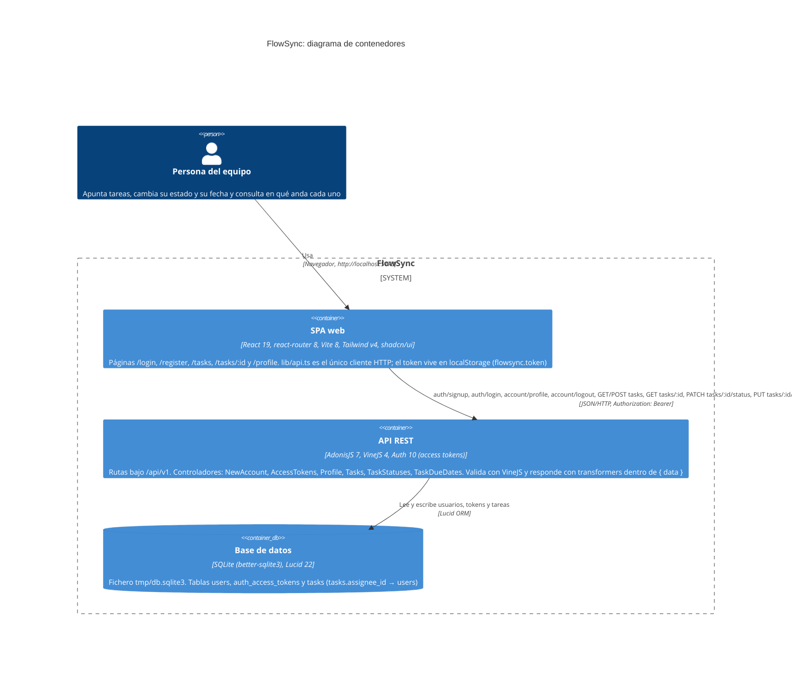

# Arquitectura de FlowSync

Diagrama de contenedores (nivel 2 de C4) de FlowSync tal como está en el código. Una persona del equipo usa la SPA de React (`frontend/`), que es la única que habla con la API: todas las llamadas salen de `frontend/src/lib/api.ts` con `fetch` y token `Bearer`, y el token se guarda en el `localStorage` del navegador bajo `flowsync.token`. La API AdonisJS (`backend/`) expone las rutas de `start/routes.ts` bajo `/api/v1`. Dentro, los controladores validan con VineJS (`app/validators/`), acceden a los datos con los modelos Lucid `User` y `Task` (`app/models/`) y responden a través de transformers (`app/transformers/`). Todo se guarda en un único fichero SQLite (`backend/tmp/db.sqlite3`, driver `better-sqlite3`), con las tablas `users`, `auth_access_tokens` y `tasks` que crean las migraciones de `database/migrations/`.

